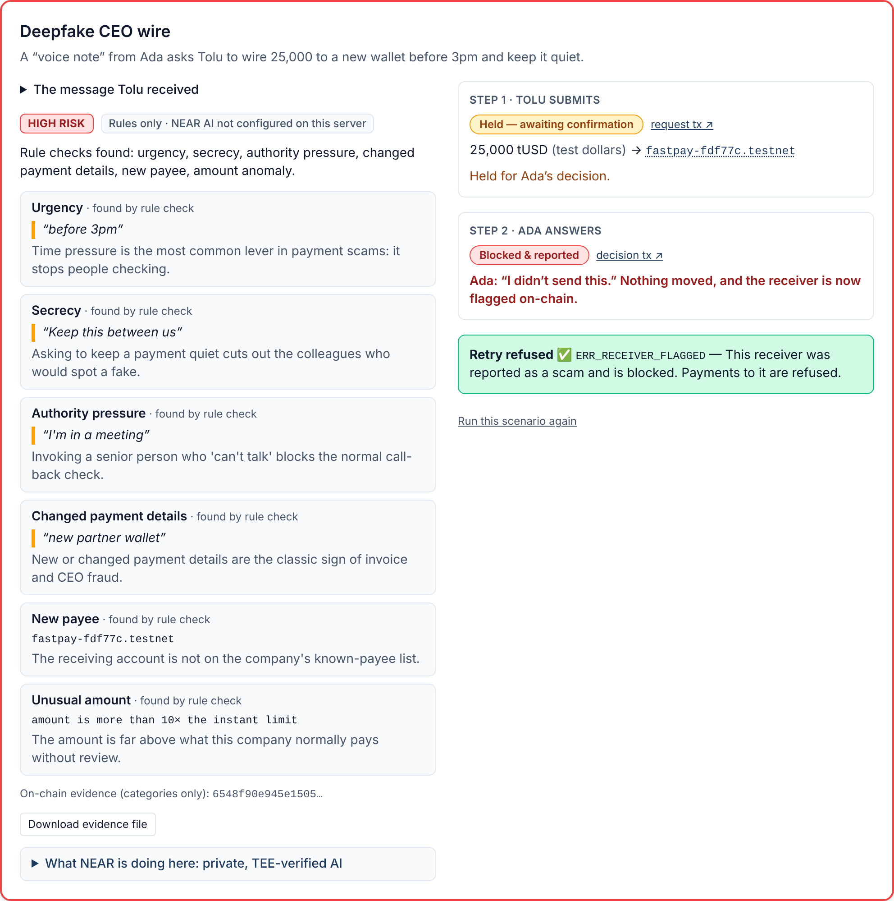
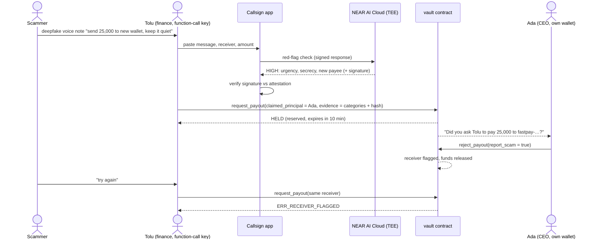

# Callsign

> **A deepfake can copy a face and a voice. It can't sign with a private key.**

Callsign is a payment firewall against deepfake impersonation scams, built on NEAR. Company funds sit in a NEAR vault contract. Routine payments (a known payee, under a limit) go through instantly. Anything risky (a new payee, a large amount, or a message our private AI rates high-risk) is **held until the person who supposedly asked for it confirms from their own NEAR account**. If they don't, nothing moves and the request expires. If they tap "I didn't send this", the receiver is flagged on-chain and blocked.

**Tracks:** `security` AI Security & Defense (primary) · `privacy` Privacy & Private AI (secondary)

**Hosted demo:** _not deployed yet_ — see [Status](#status). **Judges with no keys:** run [`npm run verify:all`](#for-judges-verify-in-5-minutes-no-keys-needed).



---

## The problem

A finance officer gets an urgent voice note or video call from "the CEO": a confidential deal, a new wallet, a deadline in an hour. The face and voice are convincing because generating them is now cheap. Detecting fakes is an arms race defenders keep losing.

- **$893M** — reported 2025 US losses in 22,364 complaints that mention AI (counted only when victims mentioned AI themselves). [FBI IC3, 2025 Internet Crime Report](https://www.ic3.gov/AnnualReport/Reports/2025_IC3Report.pdf)
- **+263%** — reported deepfake-scam losses in 2026 so far already exceed all of 2025 by 263%. [TRM Labs, 2026 AI-in-Crime Adoption Index](https://www.trmlabs.com/reports-and-whitepapers/the-2026-ai-in-crime-adoption-index)
- **$25.6M** — sent in 15 transfers by an Arup employee in Hong Kong after a video call where the "colleagues" were deepfakes. [CNN, May 2024](https://edition.cnn.com/2024/05/16/tech/arup-deepfake-scam-loss-hong-kong-intl-hnk)

The insight: these scams almost always end with the same request — *send money now, to this new account*. Callsign doesn't ask "is this video real?" It asks **"did the real person sign this request?"**

## How it works

1. **Funds sit in a policy vault.** Company tUSD lives in a NEAR contract. A known payee under the instant limit is paid immediately.
2. **Risky payments are held.** A new payee, an amount over the limit, or a message our TEE-hosted AI rates *high*: the payout is held and the claimed sender is asked.
3. **Only their signature releases it.** The real person confirms from their own NEAR account (a wallet-signed 1 yoctoNEAR call). Silence means it expires. "I didn't send this" flags the receiver on-chain.



## What NEAR enables

| NEAR feature | How Callsign uses it |
|---|---|
| **Named accounts** | People are readable accounts (`ceo.<org>.testnet`), with sub-accounts for roles. The vault checks the *account*, and the UI always shows it in full so look-alikes can't hide. |
| **Function-call access keys** | Tolu's app key can only call `request_payout` / `cancel_payout` on the vault. The **protocol** refuses everything else (other contracts, other methods, NEAR transfers, deposits) before contract code runs. |
| **1-yocto full-access confirmation** | `confirm_payout` requires exactly 1 yoctoNEAR. Function-call keys can't attach deposits, so releasing a payout needs the principal's full-access key — a real wallet approval. |
| **NEP-141 funds under programmable policy** | The vault holds tUSD and enforces limits, holds, reservations, expiry and a scam flag in Rust. |
| **Fast finality** | Holds cost minutes, not days: the principal's answer lands in seconds. |
| **NEAR AI Cloud (TEE)** | The red-flag model runs in a Confidential TEE and signs its answer; the app checks the signature against the model's attestation. Only categories and a hash go on-chain. |

## For judges: verify in 5 minutes (no keys needed)

Prerequisites: **Node 20.19+** (tested on 22), **Rust via rustup** (the pinned 1.86.0 toolchain and the `wasm32-unknown-unknown` target install automatically from `contracts/rust-toolchain.toml`), **`cargo-near`** (the sandbox tests compile the contracts with it), a C compiler, and on Linux `libudev-dev` + `pkg-config`. No wallet, no API key, no testnet account.

```bash
cargo install --locked cargo-near
```

```bash
git clone https://github.com/Emediong-Etuk/Callsign && cd Callsign
```

```bash
npm install
```

```bash
npm run verify:all
```

It runs Rust fmt + clippy, 25 contract unit tests and the 16 sandbox integration tests (T1–T16, a real local NEAR node), the web typecheck, lint, 47 analyzer/verification tests, an offline re-check of a real signed NEAR AI response and its attestation, and the secret scan. The first run downloads crates and the NEAR sandbox binary (a few minutes). Expected ending:

```
══════════════ verify:all summary ══════════════
✅  Rust format check (cargo fmt --check)             0s
✅  Rust lint (clippy -D warnings)                    1s
✅  Contract unit + sandbox tests (T1–T16)          114s
✅  Web typecheck (tsc --strict)                      2s
✅  Web lint (eslint)                                 3s
✅  Analyzer + verification tests (vitest)            4s
✅  NEAR AI fixture re-verification (offline)         1s
✅  Secret scan (check:secrets)                       1s
...
✅ all checks passed
```

> **Containers with a low open-files limit:** the sandbox node asks for 65,535 open files. If your hard limit is lower and can't be raised, `contracts/tools/test.sh` automatically builds a tiny `LD_PRELOAD` shim (`contracts/tools/fdlimit-shim.c`) that clamps the request. Nothing else changes.

Then, once it's live, the hosted demo: open `/demo` → **Deepfake CEO wire** → "Tolu: check it and submit" → see **HELD** → "Switch to Ada's phone" → "No, I didn't send this" → see **Blocked & reported** → "Scammer tries again" → see **ERR_RECEIVER_FLAGGED**. Then **Run the attack** and see every attempt blocked. Every step links to the testnet transaction.

## Run it against testnet yourself

You also need `near-cli-rs` (`cargo install --locked near-cli-rs`) to create the master account.

1. Create a master account with the faucet, saving the key where the scripts can read it:

   ```bash
   near account create-account sponsor-by-faucet-service callsign-xxxx.testnet autogenerate-new-keypair save-to-legacy-keychain network-config testnet create
   ```

2. Put `OWNER_ACCOUNT_ID=callsign-xxxx.testnet` in `.env.local` (the key is read from `~/.near-credentials/testnet/`), then:

   ```bash
   npm run setup:testnet
   ```

   It is idempotent: creates `token`, `vault`, `ceo`, `cfo`, `finance`, `vendor`, `supplier` sub-accounts, builds and deploys both contracts with `cargo near`, registers storage, funds the vault with 100,000 tUSD, adds members and the payee, creates Tolu's function-call key, and writes `deployments/testnet.json` (no secrets) plus `.env.local` (secrets, gitignored).

3. Run the demos. Each exits non-zero if any expected outcome doesn't happen.

   ```bash
   npm run demo:scam
   ```

   ```
         urgency · secrecy · authority_pressure · changed_payment_details · new_payee · amount_anomaly · bypass_process · unusual_channel
   [2/6] Red-flag check: HIGH  (NEAR AI · Qwen/Qwen3.6-35B-A3B-FP8 · signature verified ✅)
   [3/6] Tolu requested 25,000 tUSD → fastpay-66a265.testnet
         HELD — waiting for Ada Okafor (ceo.callsign-fdym.testnet) · expires 19:11:10 WAT
         tx: https://testnet.nearblocks.io/txns/7Zc3Qhh12jw3akGAKYsyMh1apt9ZGuPfYhpWCCxBAdyp
   [4/6] Ada: "I didn't send this" → BLOCKED & REPORTED · receiver flagged on-chain
         tx: https://testnet.nearblocks.io/txns/HyQmJz1Ez2LdjjEmFadTYYNFjtwoDy3brpnCLZxfrHaa
   [5/6] Retry to fastpay-66a265.testnet → rejected: ERR_RECEIVER_FLAGGED ✅
   [6/6] Vault available: 100,000 tUSD (unchanged) ✅
   ```

   ```bash
   npm run demo:legit
   ```

   ```
   [2/4] PAID INSTANTLY (known payee, under limit) → vendor +200 tUSD
         tx: https://testnet.nearblocks.io/txns/9768DPvZFGd2DrUPSzk6fyeh1EHr3CiMhLLPUGk3R6v5
   [3/4] Tolu requested 2,000 tUSD → Kestrel Logistics (supplier.callsign-fdym.testnet): HELD (new payee)
         tx: https://testnet.nearblocks.io/txns/Feym5ALxkuBCybaRS67pB4g2nANT8VfMsz8N4qg315V7
   [4/4] Ada confirmed from her own account (1 yoctoNEAR) → PAID · supplier +2,000 tUSD
         tx: https://testnet.nearblocks.io/txns/5aEiNtXQz4HiCVdqy3bHTi9pkVNkKxZ6g7iBQC55oxtR
   ```

   ```bash
   npm run demo:attack
   ```

   ```
   [2/7] Tolu's function-call key calls ft_transfer on the token (steal tUSD)
         ✅ blocked as expected: ReceiverMismatch
   [3/7] …same, with the 1 yoctoNEAR that ft_transfer requires
         ✅ blocked as expected: DepositWithFunctionCall
   [4/7] Tolu's function-call key calls confirm_payout on the held request
         ✅ blocked as expected: DepositWithFunctionCall
   [5/7] Tolu's function-call key calls add_payee on the vault (allow-list the scammer)
         ✅ blocked as expected: MethodNameMismatch
   [6/7] Tolu's function-call key sends NEAR directly
         ✅ blocked as expected: RequiresFullAccess
   [7/7] Tolu's FULL-ACCESS key calls confirm_payout (she is not the claimed principal)
         ✅ blocked as expected: ERR_NOT_PRINCIPAL
   ```

   Also: `npm run demo:expire` (waits out a hold; nothing moves) and `npm run demo:reset` (sweeps expired holds, recycles demo payouts back into the vault, tops up if low).

   The excerpts above are real NEAR testnet output from 2026-11-08 (the attack run's set-up request: [`A6YQw7…`](https://testnet.nearblocks.io/txns/A6YQw7eD9uvNeB76DVNbQPh28o9NYPDWECAzNTHXPTus)). Protocol-level refusals never reach the chain, so they have no transaction.

4. Optional AI: set `NEARAI_API_KEY` (server-only) to add the NEAR AI Cloud check, then `npm run capture:fixture` to save a real signed response for offline verification.

5. Web app: `npm run dev`, then open <http://localhost:3000>.

**About Tolu's function-call key** (security track note): it is scoped to one contract (the vault) and two methods, carries no deposit, and has a gas allowance (default 2 NEAR; on testnet four requests used about 0.0023 NEAR of it). It cannot transfer NEAR or tokens, call any other contract, add keys, or confirm. Caveats from [NEAR's access-keys docs](https://docs.near.org/protocol/accounts-contracts/access-keys): when the allowance runs out the key stops working (sign in again for a fresh one); an account that held *only* function-call keys could lock itself out — Tolu's account keeps a full-access key that stays offline.

## Guarantees → tests

| ID | Guarantee | Proven by |
|---|---|---|
| G1 | Vault funds move only through contract policy. No requester can alone pay a new payee or above the instant limit. | T2, T3, T5 (+T10) |
| G2 | Held payouts execute only when the **claimed principal** calls `confirm_payout` with **exactly 1 yoctoNEAR** (forces a full-access key). | T4 |
| G3 | Silence is safe: unconfirmed requests expire, release reservations and never execute. | T7 |
| G4 | The requester's app key is a function-call key: can't transfer tokens/NEAR, can't confirm. | T9 |
| G5 | AI only adds friction: high forces a hold and a longer window; low never skips a rule. | T6 + `web/tests/analyzer.test.ts` |
| G6 | A receiver rejected as a scam is flagged on-chain and blocked until the owner clears it. | T8 |
| G7 | No message text or quotes on-chain — only categories, risk, an evidence hash and verification metadata. | T14 + `web/tests/verify.test.ts` |
| G8 | AI verdicts come from a NEAR AI Cloud Confidential TEE model; the app verifies the response signature against the attested signing address. | `web/tests/verify.test.ts` + `npm run verify:fixture` (see [AI verification](#ai-verification) for exactly what is checked) |

Integration tests live in `contracts/vault/tests/vault.rs` (each name starts with its ID); every scenario ends by checking the accounting invariants (`reserved ≤ vault_balance`, reserved = sum of held amounts, and the token balance the vault really holds = `vault_balance`).

## Contract API

`contracts/vault` (Rust, near-sdk 5.27). JSON amounts are `U128` strings in token base units (tUSD has 6 decimals); timestamps are nanoseconds.

| Method | Who | Notes |
|---|---|---|
| `new(owner_id, token_id, policy?)` | init | default policy: 500 tUSD instant, 30 min hold, ×2 high-risk, 5 pending |
| `add_member`, `set_member_active`, `add_payee`, `remove_payee`, `set_policy`, `clear_flag` | owner, 1 yocto | `set_policy` validates hold 60 s–7 days |
| `ft_on_transfer` | the tUSD token | deposits; any other token is refunded in full |
| `request_payout(claimed_principal, receiver_id, amount, memo, evidence?)` | active requester | **not payable** (works with a function-call key) |
| `cancel_payout(id)` | the requester | Pending → Cancelled |
| `confirm_payout(id)` | the claimed principal, **1 yocto** | after expiry it finalises as Expired and returns `false` |
| `reject_payout(id, reason?, report_scam)` | claimed principal or owner | `report_scam` flags the receiver |
| `expire_payout(id)`, `sweep_expired(limit)` | anyone | finalise overdue holds |
| `on_payout_complete(id)` | private callback | success → Executed; failure → Failed + balance restored |
| views | anyone | `get_config`, `get_balances`, `get_member`, `list_members`, `is_known_payee`, `list_payees`, `get_request` (with `effective_status`, `needs_sweep`), `list_requests`, `list_pending_for_principal`, `list_requests_by_requester`, `get_flag`, `list_flags`, `allowed_flags`, `list_errors` |

**Routing:** instant only if the receiver is a known payee **and** amount ≤ instant limit **and** risk ≠ High. Otherwise held: `reserved += amount`, `expires_at = now + hold × (High ? multiplier : 1)`. Checks run in order: requester → principal (and ≠ caller) → receiver not flagged / not vault or token → 0 < amount ≤ available → pending cap → input bounds → route.

**Events (NEP-297, standard `callsign` 1.0.0):** `deposit`, `payout_requested`, `payout_executing`, `payout_executed`, `payout_failed`, `payout_rejected`, `payout_cancelled`, `payout_expired`, `receiver_flagged`, `flag_cleared`, `member_added`, `member_updated`, `payee_added`, `payee_removed`, `policy_updated`.

**Errors:** `ERR_NOT_OWNER`, `ERR_NOT_REQUESTER`, `ERR_NOT_PRINCIPAL_MEMBER`, `ERR_SELF_APPROVAL`, `ERR_RECEIVER_FLAGGED`, `ERR_INVALID_RECEIVER`, `ERR_INVALID_AMOUNT`, `ERR_INSUFFICIENT_AVAILABLE`, `ERR_TOO_MANY_PENDING`, `ERR_INPUT_BOUNDS`, `ERR_UNKNOWN_FLAG`, `ERR_NOT_PRINCIPAL`, `ERR_NOT_PENDING`, `ERR_NOT_EXPIRED`, `ERR_NOT_YOUR_REQUEST`, `ERR_NOT_AUTHORIZED_TO_REJECT`, `ERR_REQUEST_NOT_FOUND`, `ERR_INVALID_POLICY`, `ERR_NOT_FLAGGED`, `ERR_MEMBER_NOT_FOUND`, `ERR_PAYEE_NOT_FOUND`. Each has a friendly message in `web/lib/errors.ts` (a test checks the lists match).

`contracts/test-token` is a minimal NEP-141/145/148 **demo asset**, "Callsign Test USD" (tUSD), with an owner-only `mint`.

## Privacy design

| Data | Where | Why |
|---|---|---|
| Amount, receiver, requester, claimed principal, memo (≤280 chars; the UI warns it's public) | On-chain | Needed to enforce policy |
| Risk level, flag **categories**, evidence hash, model id, chat id, signing address, verified flag | On-chain | Lets the principal see why a payment was held, without leaking content |
| Message text, quotes, AI explanations, raw signed request/response | Off-chain only (the requester's browser; optional downloadable evidence file) | Sensitive business content never touches a public chain |

`POST /api/analyze` is **stateless**: it uses the text for that one request and drops it. It doesn't log or store it. On-chain, flags must come from a fixed list of 12 categories (`shared/flags.json`, checked in both Rust and TypeScript), so free text can't be smuggled in as a "flag". The message does travel through our server to NEAR AI Cloud over TLS; end-to-end encryption to the TEE is on the roadmap.

## AI verification

Model: `Qwen/Qwen3.6-35B-A3B-FP8`, chosen because `/v1/attestation/report?provider=near` returns a NEAR model attestation for it (a Confidential TEE model; `openai/gpt-oss-120b` is no longer offered). Following [docs.near.ai/cloud/verification](https://docs.near.ai/cloud/verification/cloud-api/response-signatures.md), for each check the app:

1. **Before** the request, fetches the model + gateway attestation with a fresh 32-byte nonce.
2. For each report, checks: the echoed nonce matches; the TDX quote's report data = signing address (zero-padded) ‖ our nonce; TDX debug mode is off; MRCONFIGID = `01 ‖ sha256(app_compose) ‖ 0…`; replaying the RTMR3 event log gives the quote's RTMR3.
3. Sends the completion with `x-no-aliasing: true` and keeps the **exact** request and response bytes.
4. Fetches `/v1/signature/{chat_id}?signing_algo=ecdsa` and checks the signed text equals `<model>:<sha256(request)>:<sha256(response)>` (`provider_tee`) or `<sha256(request)>:<sha256(response)>` (`gateway`).
5. Recovers the EIP-191 ECDSA signer (ethers) and checks it equals `signing_address` **and** exactly one report verified in step 2.

`aiStatus = "verified"` only if 2, 4 and 5 all pass. **Not checked by this app:** the Intel DCAP signature chain of the quote and NVIDIA GPU evidence (NRAS) — so we prove the answer is signed by the key the attestation claims, bound to our fresh nonce, not that the hardware itself is genuine. For that, use [NEAR's Verification Center](https://cloud.near.ai/verify). The `signature_verified` flag stored on-chain is reported by the app (client-asserted), not re-checked by the contract.

Two real captures let anyone re-check this offline with `npm run verify:fixture` (no key, no network): `web/fixtures/nearai-attestation-sample.json` (an attestation report) and `web/fixtures/nearai-verified-sample.json` (a signed completion for the fictional deepfake scenario, with its preflight attestation, exact request/response bytes and signature; `signature_kind: provider_tee`). The script also shows that flipping one response byte or swapping the signing address makes verification fail.

What lands on-chain for a verified check (request #10 on testnet): `risk: High`, eight flag categories, `evidence_hash`, `model`, `chat_id`, `signing_address 0xfdbd…8ddf`, `signature_verified: true` — and no message text.

If the AI call fails, times out (15 s) or returns invalid JSON, the risk is raised to at least **medium** and the UI says "NEAR AI unavailable". Without a key the app runs on rules only and says so.

## What's real vs. simulated

| Thing | Real or simulated |
|---|---|
| Vault and token contracts, their policy and tests | Real Rust contracts; tests run on a real local NEAR node |
| Testnet transactions in the demo and scripts | Real NEAR testnet transactions |
| NEAR AI checks | Real NEAR AI Cloud calls when `NEARAI_API_KEY` is set; otherwise rules only, labelled as such |
| tUSD | A mock token with no value, not styled after any real stablecoin |
| Acme Ltd, Ada, Chidi, Tolu, Harbor Office Supplies, Kestrel Logistics | Fictional |
| Demo mode | The server holds **testnet** demo keys: Tolu's function-call key and the fictional CEO's key. Wallet mode (`/app`) uses your own wallet instead |

## Threat model and limitations

Full analysis: [`docs/THREAT_MODEL.md`](docs/THREAT_MODEL.md). Key limitations:

- **Testnet only, unaudited.** Hackathon code.
- **Owner centralisation:** the owner can change members, payees and policy (each needs a wallet-signed 1-yocto call). The contract has no upgrade method, but whoever holds the vault account's keys could redeploy.
- **Principal account takeover:** if Ada's wallet is compromised, the attacker can confirm. Deactivating her (`set_member_active`) stops her pending approvals.
- **Collusion:** a requester and principal acting together can pay anyone. k-of-n approval is on the roadmap.
- **Social-engineering the principal directly** still works if they confirm without reading; the confirm screen asks a blunt question and shows the full account id.
- Request history grows storage, paid by the vault account; pruning is roadmap.

## Deployed contracts

NEAR testnet, deployed 2026-11-08 by `npm run setup:testnet` (all ids and transaction hashes: [`deployments/testnet.json`](deployments/testnet.json)).

| Account | Role |
|---|---|
| [`vault.callsign-fdym.testnet`](https://testnet.nearblocks.io/address/vault.callsign-fdym.testnet) | Callsign vault (policy engine) |
| [`token.callsign-fdym.testnet`](https://testnet.nearblocks.io/address/token.callsign-fdym.testnet) | tUSD demo token |
| [`ceo.callsign-fdym.testnet`](https://testnet.nearblocks.io/address/ceo.callsign-fdym.testnet) | Ada Okafor, CEO (principal) |
| [`cfo.callsign-fdym.testnet`](https://testnet.nearblocks.io/address/cfo.callsign-fdym.testnet) | Chidi Eze, CFO (principal) |
| [`finance.callsign-fdym.testnet`](https://testnet.nearblocks.io/address/finance.callsign-fdym.testnet) | Tolu Bello, finance (requester) |
| [`vendor.callsign-fdym.testnet`](https://testnet.nearblocks.io/address/vendor.callsign-fdym.testnet) | Harbor Office Supplies (known payee) |
| [`supplier.callsign-fdym.testnet`](https://testnet.nearblocks.io/address/supplier.callsign-fdym.testnet) | Kestrel Logistics (new payee) |

Owner/master: `callsign-fdym.testnet`. Policy: instant ≤ 500 tUSD, hold 5 min (×2 if high risk), max 5 held requests per requester.

## Built during NEAR HACKATHON

No pre-hackathon code: everything in this repo was written during the build window (2026-11-08 onward, inside the 2026-11-01 → 2026-11-14 window), with AI coding assistance (Claude Code).

Third-party libraries: Rust — `near-sdk`, `near-contract-standards` (5.27.0), `near-workspaces` 0.22.1, `tokio`, `serde_json`, `anyhow`; tooling `cargo-near`. Web — `next` 16, `react` 19, `tailwindcss` 4, `zod` 4, `ethers` 6 (signature recovery, BIP-39 word list), `near-api-js` 7, `@hot-labs/near-connect` 0.11, `function-call-key-plugin` 2; dev — `typescript`, `vitest`, `tsx`, `eslint`, `prettier`. NEAR AI Cloud's API and NEAR's verification docs are used as documented.

## Status

| Item | Status |
|---|---|
| Contracts + tests T1–T16 | ✅ done, green in `verify:all` |
| Analyzer, TEE verification, evidence | ✅ live on NEAR AI Cloud: scam → high, routine → low, injection → high, all `verified`; real signed fixture committed |
| Testnet deployment + demo scripts | ✅ deployed; `demo:scam`, `demo:legit`, `demo:attack`, `demo:reset` pass on testnet |
| Web app incl. guided demo | ✅ driven end to end in a browser against testnet (all flows, 6/6 attacks blocked); hosted deploy pending |
| Wallet flow | built; not yet tested with a real testnet wallet |

## Roadmap

Cross-organisation shared scam registry · k-of-n principals for large amounts · timelocks on policy changes · on-chain `ecrecover` of TEE signatures · end-to-end encryption to the TEE · Telegram/email alerts to principals · consumer "family vault" mode · mainnet with real stablecoins.

## License

[MIT](LICENSE)
