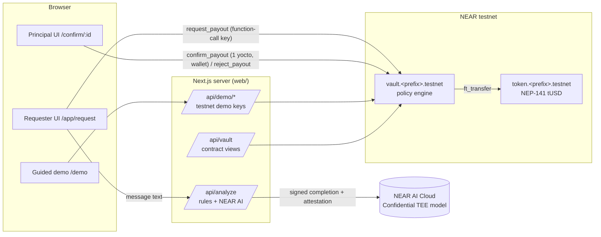
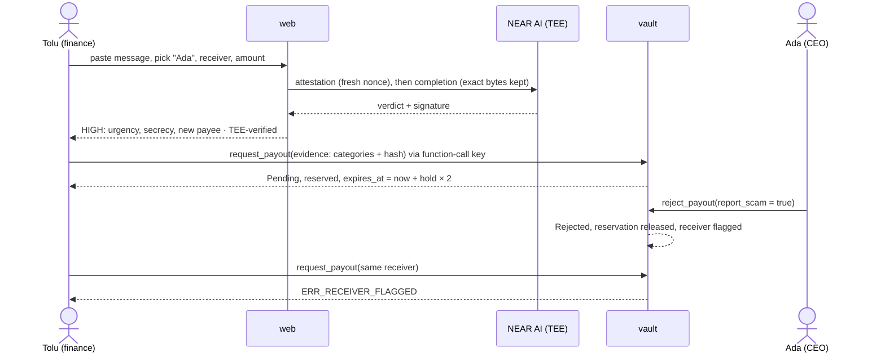
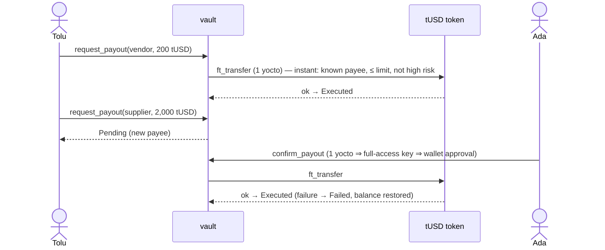
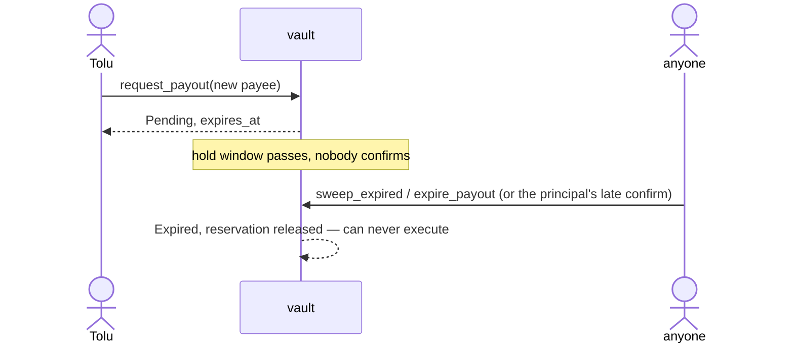

# Callsign architecture

## Components

- `contracts/vault` — Rust policy engine (near-sdk 5.27). Modules: `types` (data, flag allow-list), `policy` (pure routing/expiry/validation), `requests` (deposit + lifecycle + callback), `admin` (owner methods), `views`, `events` (NEP-297), `errors`.
- `contracts/test-token` — minimal NEP-141/145/148 tUSD.
- `web/lib/analyzer` — deterministic rules (`rules.ts`), NEAR AI client (`nearai.ts`), combination (`index.ts`, G5), evidence bundle/hash (`evidence.ts`).
- `web/lib/verify` — TDX quote checks (`tdx.ts`) and response-signature verification (`nearai-verify.ts`), both pure and offline.
- `web/lib/near` — one place for RPC, views and signed transactions; used by scripts and API routes.
- `web/scripts` — `setup-testnet`, `demo-*`, `verify-all`, `verify-fixture`, `capture-fixture`, `check-secrets`.

## Scam flow

## Legit flow

## Expiry

## Data model

`Member {display_name, title, roles[Requester|Principal], active}` · `Payee {label, added_at_ns}` · `Policy {instant_limit, hold_window_ns, high_risk_hold_multiplier, max_pending_per_requester}` · `Evidence {evidence_hash, risk, flags[], model, chat_id, signing_address, signature_verified}` · `PayoutRequest {id, requester, claimed_principal, receiver_id, amount, memo, evidence?, route, status, reported_as_scam, created_at_ns, expires_at_ns?, decided_by?, decided_at_ns?, reason?}` · `FlagInfo {reports, first_reported_by, first_request_id, flagged_at_ns}`.

State: `members`/`payees`/`flags` (`IterableMap`), `requests` (`LookupMap<u64,_>`, contiguous ids from 1), `pending_ids` (`IterableSet`), `pending_by_requester`, `requests_by_requester`, `vault_balance`, `reserved`.

Invariants (asserted after every integration test): `reserved ≤ vault_balance`; `available = vault_balance − reserved`; `reserved = Σ amount of Pending`; the token balance the vault holds = `vault_balance`; terminal states (`Executed`, `Rejected`, `Expired`, `Cancelled`, `Failed`) never change.

## Gas and storage

- `ft_transfer` gets 15 Tgas, the `on_payout_complete` callback 15 Tgas; clients attach 100 Tgas to request/confirm. Verified in the sandbox tests.
- Strings are bounded (names 64, memo/reason 280, model/chat 96, address 66, ≤10 flags of ≤32 chars). Request history is append-only and paid from the vault account's NEAR balance (~3.6 NEAR funded at setup; the wasm is ~291 KB). Pruning old requests is roadmap. The pending cap (5 per requester) bounds open holds.
